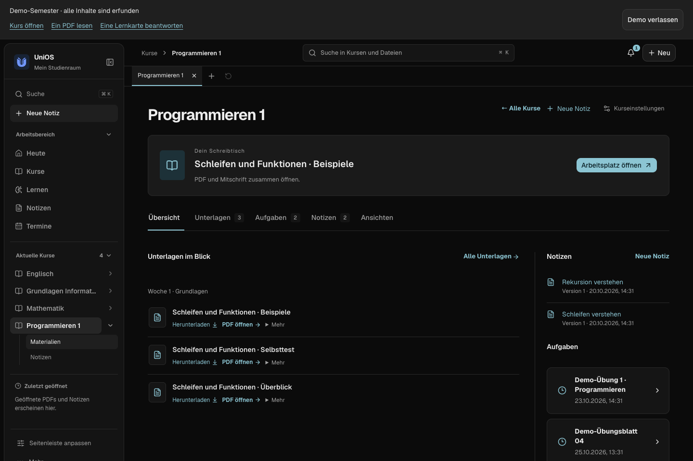
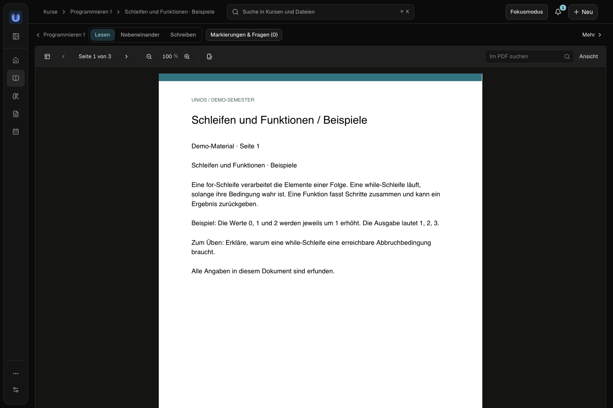
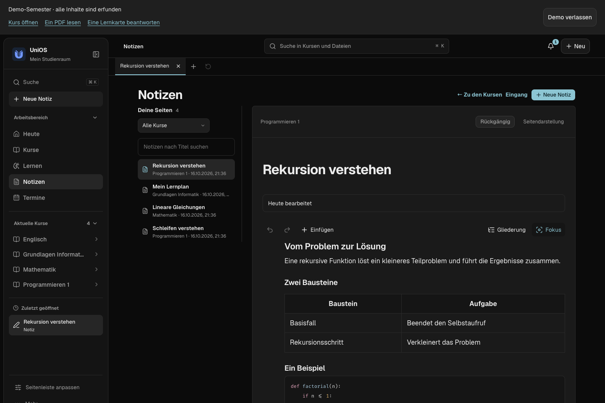
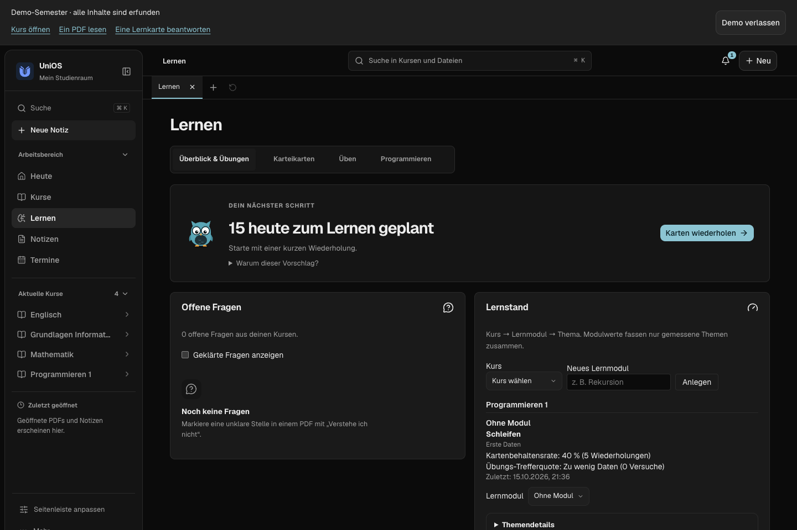
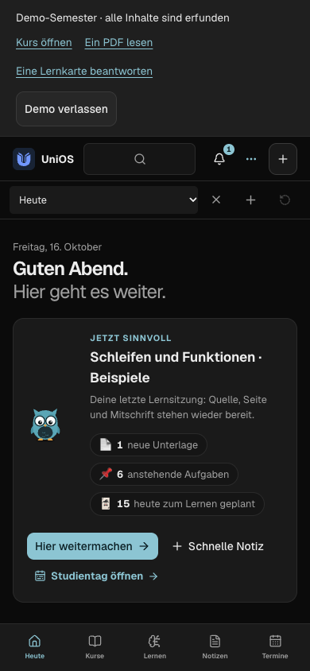
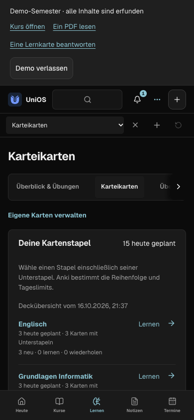

<!-- SPDX-License-Identifier: AGPL-3.0-or-later -->

<div align="center">

<h1><picture>
  <source media="(prefers-color-scheme: dark)" srcset="docs/brand/v2/logo-dark.svg">
  
</picture></h1>

### Dein Studium. Ein Arbeitsplatz.

Kurse, PDFs, Notizen, Aufgaben und Karteikarten in einer App – lokal oder auf deinem eigenen Server.

[**Neueste Version herunterladen**](https://github.com/EinfachMxrc/unios-app/releases/latest) · [Demo testen](#demo-ohne-hochschulzugang) · [Projektseite](https://einfachmxrc.github.io/unios-app/) · [Dokumentation](docs/README.md) · [English](docs/README.en.md)

[](LICENSE)
[](https://github.com/EinfachMxrc/unios-app/actions/workflows/quality.yml)

</div>


*Echte Oberfläche mit ausschließlich erfundenen Demo-Daten, [Herkunft der Bilder](docs/readme/current/SCREENSHOTS.md).*

> **Alpha.** UniOS ist ein Einzelnutzer-System im Aufbau. Pakete sind noch nicht öffentlich vertrauenssigniert. Verfügbare Pakete und Updatewege stehen in den [Release-Hinweisen](https://github.com/EinfachMxrc/unios-app/releases/latest); Hochschulverbindungen sind nur so weit geprüft, wie die [Kompatibilitätsliste](docs/COMPATIBILITY.md) und der [Prüfstand](docs/RELEASE_READINESS.md) es angeben.

## Was drin ist

| Bereich | Inhalt |
| --- | --- |
| **Kurse & Eingang** | Aktive Kurse, Moodle-Materialien und Aufgaben, Zuordnung neuer Inhalte |
| **PDFs & Suche** | Versionierte Dateien, Leser mit Markierungen und offenen Fragen, Volltextsuche, Quellenverweise bis zur genauen Stelle |
| **Notizen** | Blockeditor mit Tabellen, Code, Aufgabenlisten und Verknüpfungen; Markdown, Fokusmodus, Versionsverlauf, Papierkorb |
| **Lernen** | FSRS-Karteikarten, Übungen, Lernstand, Probeprüfungen, Programmieraufgaben mit getrenntem Runner |
| **Termine & Campus** | Stundenplan, Fristen und Lernblöcke, Mensa, Raumverfügbarkeit |
| **Erfassen** | Notizen, Textclips, Dateien und Sprachnotizen mit korrigierbarem Transkript |
| **Work** | CLI und MCP-Gateway: dein KI-Client fragt freigegebene Kurse mit Quellenbelegen ab |
| **Datensicherung** | Tägliche Sicherung in einen eigenen Ordner, Wiederherstellung beim nächsten Start |

**Verbindungen sind optional.** Notizen, Dateien und Lernen funktionieren ohne Hochschulkonto. Moodle, Mail, Mensa oder Portale kommen nur mit einer eingerichteten, zulässigen Verbindung dazu. PRIMUSS wird ausschließlich lesend angesprochen. Logins samt MFA finden auf den offiziellen Seiten statt.

## Ein Blick in UniOS

| | |
| --- | --- |
|  |  |
| **Kurs:** Material, Aufgaben und eigene Notizen zusammen | **Lesen:** PDF mit Suche und Mitschrift |
|  |  |
| **Schreiben:** Blockeditor mit Tabelle und Code | **Lernen:** nächster Schritt und Lernstand |

<details>
<summary><strong>Handyansicht (390 px)</strong></summary>

<table><tr>
<td></td>
<td></td>
</tr></table>

Das responsive Layout ist kein Nachweis einer veröffentlichten iOS-/Android-App.

</details>

## Installation

1. Lade auf der [Release-Seite](https://github.com/EinfachMxrc/unios-app/releases/latest) das passende Paket herunter und vergleiche es bei Bedarf mit `SHA256SUMS.txt`.
2. Installiere und öffne UniOS. Der Installer enthält Oberfläche und Hintergrunddienst; Python und Node.js brauchst du nicht.
3. Verbinde die App mit deinem eigenen HTTPS-Server und bestätige die einmalige Gerätekopplung: [Server-Anleitung](docs/SERVER.md).
   **Aktuell braucht die installierte Desktop-App dafür einen eigenen Server.** Ein Modus „nur auf diesem Gerät“ ist geplant ([#26](https://github.com/EinfachMxrc/unios-app/issues/26)). Bis dahin geht UniOS ohne Server nur aus dem Quellcode (siehe Demo unten; dort laufen auch Moodle und lokale Daten ohne Server) oder als Demo.
4. Wähle Hochschule und Studiengang und richte die gewünschten Quellen ein.

Welche Plattformen ein Release enthält, steht in dessen Beschreibung; der Stand je Plattform in [DESKTOP_PACKAGES](docs/DESKTOP_PACKAGES.md). **Vor einem Update eines vorhandenen Datenbestands** einen Snapshot erstellen und prüfen: [Migration und Wiederherstellung](docs/SERVER.md).

## Demo ohne Hochschulzugang

Die Demo bringt vier erfundene Kurse, PDFs, Notizen, Aufgaben und 15 Karteikarten mit, einen eigenen Datenordner und keine Verbindung zu deinem Bestand. Du brauchst Python 3.13+, [uv](https://docs.astral.sh/uv/) und Node.js 22+.

```sh
git clone https://github.com/EinfachMxrc/unios-app.git
cd unios
uv sync --locked --group dev
(cd frontend && npm ci && npm run build)
uv run unios demo create --directory demo-workspace
uv run unios demo serve --directory demo-workspace
```

Danach [http://127.0.0.1:8766](http://127.0.0.1:8766) öffnen. Weitere Optionen: `uv run unios demo --help`.

## Daten und Vertrauen

```text
Moodle · Kalender · eigene Dateien · optionale Connectoren
                         ↓
                  Eigener UniOS-Server
          Versionierte Quellen · SQLite · Suche
                         ↕
                 HTTPS + Gerätekopplung
                         ↕
              Desktop-App · CLI · MCP / Work
              Lokale Entwürfe und Offline-Cache
```

Selbst betrieben heißt: Du kontrollierst Server und Quellen. Es ist keine Ende-zu-Ende-Verschlüsselung gegenüber dem Serverbetreiber. Externe KI erhält nur Inhalte innerhalb deiner Freigaben. Details: [Daten und Berechtigungen](docs/TRUST.md) · [Architektur](docs/ARCHITECTURE.md).

Grenzen, die du vor dem Einrichten kennen solltest:

- **Mail:** Microsoft kann Administratorzustimmung verlangen. UniOS umgeht diese Vorgaben nicht ([Mail](docs/MAIL_FORWARDING.md)).
- **Räume:** Die Prüfung ist kein Belegungskalender und reserviert nichts ([Räume](docs/ROOM_BOOKING.md)).
- **Portale:** PRIMUSS und myCampus sind lesend und noch nicht für jede Hochschule abgenommen.
- **Work:** MCP liefert Daten mit Rechten und Quellen; den KI-Client richtest du separat ein ([MCP-Anleitung](clients/uni_mcp/README.md)).

## Dokumentation und Mitmachen

Alle Dokumente stehen in der [Dokumentationsübersicht](docs/README.md). Die wichtigsten Einstiege:

| Ich möchte … | Weiter |
| --- | --- |
| wissen, **was neu ist** | [Änderungen je Version](CHANGELOG.md) · [Releases](https://github.com/EinfachMxrc/unios-app/releases) |
| UniOS **benutzen** | [Erste Schritte](docs/ALPHA_FOCUS.md) · [Notizen](docs/NOTE_STUDIO.md) · [Daten und Rechte](docs/TRUST.md) |
| einen **Server** betreiben oder die App installieren | [Server](docs/SERVER.md) · [Desktop-Pakete](docs/DESKTOP_PACKAGES.md) |
| eine **Hochschule** oder Sprache ergänzen | [Hochschule hinzufügen](docs/ADD_UNIVERSITY.md) · [Übersetzen](docs/TRANSLATING.md) · [Kompatibilität](docs/COMPATIBILITY.md) |
| am **Code** mitarbeiten | [Beitragen](.github/CONTRIBUTING.md) · [Architektur](docs/ARCHITECTURE.md) · [Roadmap](docs/ROADMAP.md) |
| **Sicherheit** und Prüfstand verstehen | [Sicherheit](.github/SECURITY.md) · [Release-Abnahme](docs/RELEASE_READINESS.md) |

## Fehler melden und Fragen stellen

- **Fehler oder Idee:** In der App unter *Einstellungen → Feedback* (oder über „Problem mit dieser Seite melden“ am Seitenende) öffnet UniOS ein vorausgefülltes GitHub-Formular. Direkt: [Fehler melden](https://github.com/EinfachMxrc/unios-app/issues/new?template=bug.yml) · [Idee vorschlagen](https://github.com/EinfachMxrc/unios-app/issues/new?template=idea.yml). Nötig ist ein GitHub-Konto.
- **Mitmachen:** Einsteigerfreundliche Aufgaben tragen das Label [good first issue](https://github.com/EinfachMxrc/unios-app/labels/good%20first%20issue), etwa eine UI-Sprache oder ein Hochschulprofil ergänzen.
- **Frage oder Hilfe:** [Diskussionen](https://github.com/EinfachMxrc/unios-app/discussions).
- **Sicherheitslücke:** vertraulich über [Security → Report a vulnerability](https://github.com/EinfachMxrc/unios-app/security/advisories/new), nicht als Issue.

Nenne Version, Betriebssystem und konkrete Schritte, mit erfundenen Beispieldaten. Hochschulmails, Noten, Session-URLs und Zugangsdaten gehören nicht in öffentliche Issues.

UniOS steht unter **AGPL-3.0-or-later**: [Lizenz](LICENSE) · [Drittsoftware](THIRD_PARTY_NOTICES.md).
