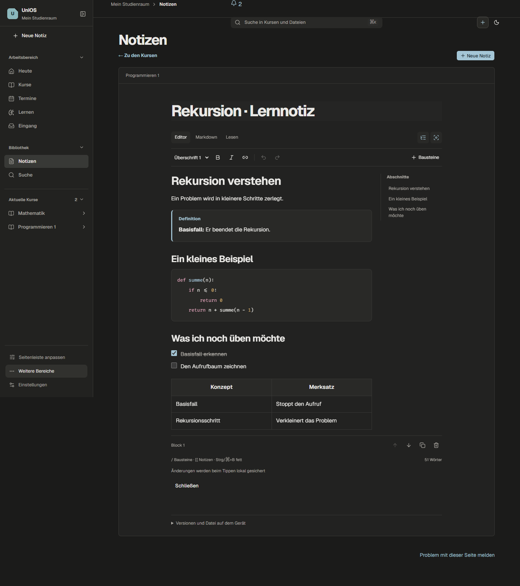

<!-- SPDX-License-Identifier: AGPL-3.0-or-later -->

# Der UniOS-Editor

Stand: 02.10.2026. Die Bilder zeigen erfundene Lernnotizen aus dem Browser-Test.



## Schreiben ohne Markdown-Kenntnisse

Zusatz vom 07.10.2026: Formeln, Gleichungsblöcke und Wahrheitstabellen lassen sich
über Vorlagen beziehungsweise lokale Berechnung einfügen, auch direkt neben dem
PDF. Bedienung und Grenzen: [Mathe und Logik mitschreiben](STUDY_WRITING.md).

Eine neue oder bearbeitete Notiz öffnet sich als direkt bearbeitbares Dokument.
Die kleine Werkzeugleiste enthält Texttyp, Fett/Kursiv, Links und Rückgängig.
`/` oder **Bausteine** öffnen die Auswahl; Pfeiltasten und Enter wählen,
Escape schließt. **Markdown** öffnet bei Bedarf den bisherigen Quelltexteditor,
**Lesen** das fertige Dokument. Auf dem Mac funktionieren die Standardbefehle
mit ⌘, auf Windows/Linux mit Strg.

- Überschriften H1–H6, Absätze, Aufzählungen, nummerierte Listen, Zitate,
  Trennlinien und anklickbare Checklisten.
- Direkt bearbeitbare Tabellen mit Aktionen für Zeilen und Spalten.
- Code mit Syntaxfarben, Sprachwahl und Fira-Code-Ligaturen. Eine sichtbare
  Ligatur verändert den gespeicherten Code nicht.
- Hinweis, Definition, Merksatz, Beispiel, Lerntipp, typischer Fehler, offene
  Frage, Wichtig, Zusammenfassung und eigener Baustein. Der Name und die Hinweisart können geändert werden; im Baustein
  sind wiederum Absätze, Listen, Tabellen und Code möglich.
- Bilder, Audio und Videos per Dateiauswahl, Dateidrop oder Einfügen aus der
  Zwischenablage. Audio/Video besitzen einen echten Player.
- Verknüpfte Notizen, Kurse, Materialien, Lernthemen, Aufgaben, Projekte und
  Prüfungen. Ziele werden über die vorhandene Entity-Auflösung geöffnet;
  bei Materialien zählt die aktuelle Dateiversion.
- `[[` ergänzt einen Notizverweis mit Vorschau und den bestehenden Rückverweisen.
- Griff zum Ziehen von Blöcken, zusätzlich Verschieben, Duplizieren und
  Entfernen über beschriftete Schaltflächen. Änderungen lassen sich rückgängig machen.
- **Abschnitte** navigiert über Überschriften. **Fokusmodus** blendet die
  Notizliste und den Kontext aus; Escape beendet ihn.

## Speichern und Grenzen

Das bestehende automatische lokale Entwurfsichern, Host-Speichern,
Versionsarchiv und die Konfliktentscheidung funktionieren weiterhin.
Bloßes Öffnen erzeugt keine neue Version. Eine Notiz darf bis zu 100.000
Zeichen enthalten; ein zu großer Einfügeversuch wird vor dem Ändern des
Dokuments verworfen und beschädigt die Undo-Historie nicht.

Medien werden unveränderlich unter `DATA_DIR/note-media/` gespeichert und
über die authentifizierte UniOS-API inklusive HTTP-Range ausgeliefert.
Dateityp wird anhand des Inhalts geprüft: PNG, JPEG, WebP, MP3, WAV, OGG,
MP4 und WebM, maximal 25 MB pro Datei. SVG und ausführbare Formate werden
nicht eingebettet. Die eigentliche Abspielbarkeit eines Videos hängt auch
vom Codec des Betriebssystems/Webviews ab. Abbrechen stoppt den Import;
bei einem Notizwechsel wird nichts in das neue Dokument eingefügt.

Externe Markdown-Bilder bleiben als Quelle erhalten und können dort geöffnet
werden; sie werden nicht stillschweigend aus fremden Domains geladen.
Importiertes HTML bleibt als inaktiver Quelltext erhalten. Der vollständige
Datenexport enthält auch die privaten Notizmedien, ohne Zugangsdaten.

## Portables Format statt Datenbankmigration

Markdown bleibt das kanonische, versionierte Format. Gewöhnliche Notizen,
Suche, Merge und Dateiexport verwenden ihren bestehenden Vertrag.
Strukturierte Blöcke verwenden dokumentierte Erweiterungen:

```markdown
:::callout {kind="definition" label="Basisfall"}

**Der Basisfall** beendet die Rekursion.

:::

:::entity {kind="course" id="1" label="Programmieren"} :::

:::media {src="/api/note-assets/<uuid>.wav" kind="audio" alt="Meine Erklärung"} :::
```

Ein gewöhnlicher Markdown-Editor zeigt unbekannte Direktiven als Text.
Die JSON-Blockstruktur bleibt eine Arbeitsdarstellung im Editor und ersetzt
nicht den vorhandenen Notizbestand. Es wird keine Datenbankmigration benötigt.

## Dieselben Blöcke über Registry und CLI

`note.blocks` liest Top-Level-Blöcke und die aktuelle Revision.
`note.edit_block` unterstützt `insert`, `replace`, `move`, `delete` und
verlangt `expected_revision` sowie explizite Bestätigung. Eine erfolgreiche
Änderung legt eine neue Notizversion an; alte Versionen bleiben erhalten.
Ein zwischenzeitlich geänderter Stand wird als Konflikt zurückgewiesen.

```shell
unios entity action note <id> note.blocks --json
unios entity action note <id> note.edit_block --input edit.json --dry-run
unios entity action note <id> note.edit_block --input edit.json --yes --json
```

Beispiel für `edit.json` (Blockindizes beginnen bei 0):

```json
{"expected_revision":1,"operation":"replace","index":0,"markdown":"# Neuer Titel"}
```

Die Aktionen sind auch in der vorhandenen UI-Aktionspalette verfügbar.
MCP darf Blöcke lesen; die Schreibaktion ist nicht für unbeaufsichtigte
MCP-Aufrufe freigegeben. Bestehende Kurs- und Rechtefreigaben gelten weiter.

## Abhängigkeiten und Performance

Tiptap 3.31.4 / ProseMirror liefern Tastaturbedienung, Auswahl, Tabellen,
Undo und Blockbewegungen. Die freien Extensions werden exakt versioniert.
Lowlight färbt Code; Fira Code liefert Ligaturen. Kein kostenpflichtiger
Cloud-Editor oder zusätzlicher externer Dienst wird verwendet.
Die Tiptap-Markdown-Erweiterung ist upstream noch als Beta ausgewiesen;
die unterstützten Standard- und UniOS-Blöcke sind mit Roundtrip-Tests abgesichert.

Die Notizseite einschließlich Editor wird als separater Chunk geladen.
Das Hauptbundle bleibt mit etwa 127 KiB gzip unter seinem festen 220-KiB-Budget.
Kontrollen, Leerraum, Farben und Größen verwenden die bestehenden App-Tokens;
Desktop und 390 px werden in Hell/Dunkel geprüft.

## Geräteprüfung

Automatisierte Prüfungen verwenden ausschließlich Fake-Dienste und erfundene
Notizen. Auf echten Geräten noch prüfen: IME/Diktat, Systemzwischenablage,
Dateidrop aus Finder/Explorer, installierte Webview-Videocodecs und
Mac-Tastaturbefehle. Diese Arbeit installiert keine neue Desktop-Version.


## Lernbuch-Mitschriften und GPT (14.10.2026)

**Bausteine** oder `/` bieten die Lernkästen an. „Hinweisart“ und „Name des
Bausteins“ ändern Art und Überschrift. Jede Art hat ein Symbol und ein lesbares
Etikett; Farbe allein trägt keine Bedeutung. Formeln, Quellenlinks, Listen und
Tabellen bleiben innerhalb der Kästen verwendbar. Merksätze sparsam einsetzen,
Beispiele schrittweise erklären und Voraussetzungen ausdrücklich nennen.

GPT kann dasselbe portable Format liefern:

```markdown
:::callout {kind="memory" label="Stellenwerte merken"}

Jede Stelle hat das Gewicht $2^k$. [Quelle, Seite 5](/material/17?page=5)

:::
```

Weitere Arten: `definition`, `example`, `tip`, `pitfall`, `question`, `warning`,
`summary`, `note`, `custom`. Der kopierbare Vorlesungsauftrag beschreibt das
Format und verlangt Themen-/Seitengliederung, vollständige wichtige Herleitungen,
Quellenbelege, erkennbare eigene Erklärungen und sichtbare Quellenlücken. Kein
automatischer GPT-Aufruf, keine unbelegte Behauptung zur Prüfungsrelevanz.

## Moodle-Aufgaben selbst bearbeiten

In der Kurs-Aufgabenansicht öffnet **In der App bearbeiten** eine eigene
Notizvorlage mit Aufgabenstellung, Lösungsweg, Kontrolle und offenen Fragen.
Formeln, Rechenraster, Tabellen und Lernkästen sind verwendbar. Der Link zur
aktuellen Aufgabe zeigt deren aktuellen Termin; die Notiz hält die beim Öffnen
bekannte Aufgabenstellung als Zitat fest. Neue Notiz erst nach „Notiz anlegen“;
vorhandene lokale Entwürfe bleiben erhalten und haben Vorrang vor der Vorlage.
Die Lösung ist eine eigene Notiz, keine automatische Bewertung oder Moodle-Abgabe.
PDF-Aufgaben und Diagramme bleiben über das Kursmaterial erreichbar.


## Textmarker und einklappbare Abschnitte (14.10.2026)

Text auswählen → **Text markieren** in der Werkzeugleiste. **Markerfarbe** bietet
Gelb, Grün, Blau und Rosa; **Markierung entfernen** behält die Wörter. Bei einer
Auswahl wird nur diese geändert, am Cursor innerhalb einer Markierung deren
vollständiger Bereich. ⌘/Strg+Umschalt+H schaltet den Marker um. Fertig getipptes
`==Text==` wird ebenfalls markiert; farbiges Markdown bleibt portabel:
`=={green}Text==`, `=={blue}Text==`, `=={pink}Text==`. Code bleibt wörtlich.

**Bausteine → Einklappbarer Abschnitt** fasst die aktuellen oder ausgewählten
Absätze zusammen, ohne ihren Inhalt zu ersetzen. An einem leeren Absatz entsteht
ein neuer Abschnitt. **Abschnittstitel** benennt ihn; Formeln, Listen, Tabellen
und Lernkästen bleiben darin editierbar. **Außerhalb weiterschreiben** oder
⌘/Strg+Enter setzt den Cursor nach den Abschnitt und legt bei Bedarf einen Absatz
an. Auf-/Zuklappen erzeugt keine neue Notizversion. Im Editor sind Abschnitte
anfangs geöffnet, beim Lesen geschlossen; Drucken zeigt auch verborgenen Inhalt.
Tastatur: die Abschnitts-Schaltfläche mit Tab erreichen, mit Enter/Leertaste
öffnen. Bei reduzierter Bewegung entfällt die Pfeilanimation.

```markdown
:::fold {label="Herleitung Schritt für Schritt"}

Eine Erklärung mit **Zwischenschritten**, Formeln und konkreten Quellenlinks.

:::
```

GPT erhält die neuen Formate im kopierbaren Vorlesungsauftrag. Die wichtigsten
Aussagen sollen sichtbar bleiben; lange Herleitungen und Selbsttest-Antworten
können eingeklappt werden. Keine neue Abhängigkeit oder Datenbankmigration.
