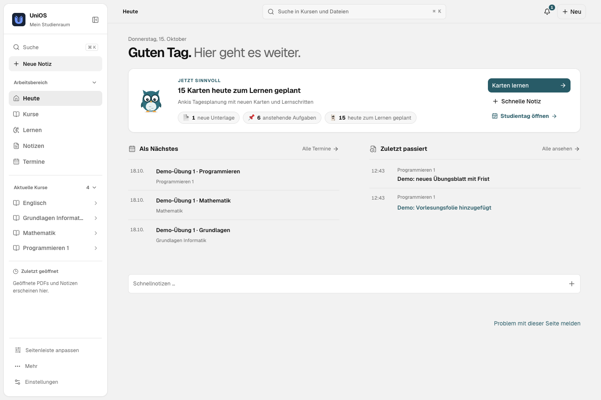

<!-- SPDX-License-Identifier: AGPL-3.0-or-later -->

<div align="center">

<h1><picture><source media="(prefers-color-scheme: dark)" srcset="brand/v2/logo-dark.svg"></picture></h1>

### Your studies. One workspace.

Courses, PDFs, notes, assignments and flashcards in one app, local or on your own server.

[**Download the latest release**](https://github.com/EinfachMxrc/unios-app/releases/latest) · [Deutsch](../README.md) · [AGPL-3.0-or-later](../LICENSE)

</div>

<picture><source media="(prefers-color-scheme: dark)" srcset="readme/current/heute-dark.png"></picture>

*Real UI with invented demo data only, [provenance](readme/current/SCREENSHOTS.md). The UI pictured is German.*

> **Alpha.** UniOS is a single-user system under construction. Packages are not publicly trust-signed yet, automatic updates are off, and university connections are verified only as far as [Compatibility](COMPATIBILITY.md) and [Release readiness](RELEASE_READINESS.md) state.

## What is inside

- **Courses and inbox:** Moodle materials and assignments, sorted into your courses.
- **PDFs and search:** versioned files, reader with highlights and open questions, full-text search, citations that jump to the exact passage.
- **Notes:** block editor with tables, code, task lists and links; Markdown, focus mode, version history, trash.
- **Learning:** FSRS flashcards, exercises, mastery overview, mock exams, coding tasks with a separate runner.
- **Schedule and campus:** timetable, deadlines, study blocks, canteen, room availability.
- **Work:** CLI and MCP gateway so your AI client can query shared courses with source citations.
- **Backup:** daily backup to a folder you choose, restore on next start.

Connections are optional. Notes, files and learning work without a university account. PRIMUSS is only ever read.

## Install

1. Download the matching package from the [latest release](https://github.com/EinfachMxrc/unios-app/releases/latest) and compare it with `SHA256SUMS.txt`.
2. Install and open UniOS. No Python or Node.js is needed on your device.
3. Connect the app to your own HTTPS server and confirm the one-time device pairing: [Server guide](SERVER.md) (German).
4. Pick your university and programme and set up the sources you want.

The release notes list which platforms each release contains. Snapshot and verify your data before updating an existing installation.

## Try the demo

Needs Python 3.12+, [uv](https://docs.astral.sh/uv/) and Node.js 22+.

```sh
git clone https://github.com/EinfachMxrc/unios-app.git
cd unios
uv sync --locked --group dev
(cd frontend && npm ci && npm run build)
uv run unios demo create --directory demo-workspace
uv run unios demo serve --directory demo-workspace
```

Then open [http://127.0.0.1:8766](http://127.0.0.1:8766). The demo has four invented courses and its own data folder.

## More

[Documentation](README.md) (mostly German) · [Contributing](../.github/CONTRIBUTING.md) · [Security](../.github/SECURITY.md) · [Translating the UI](TRANSLATING.md) · [Third-party notices](../THIRD_PARTY_NOTICES.md)

UniOS is licensed under **AGPL-3.0-or-later**.
