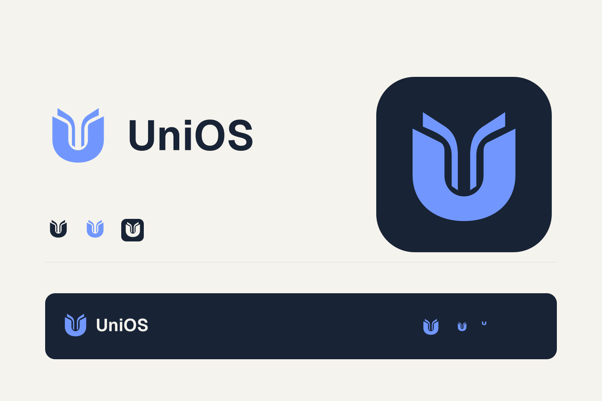

<!-- SPDX-License-Identifier: AGPL-3.0-or-later -->

# UniOS – Logo und App-Icon

Das Zeichen verbindet ein U mit aufgeklappten Buchseiten. Die Wortmarke benutzt
Geist in Gewicht 650; ihre Buchstaben sind als Vektorpfade gespeichert, sodass
die Schrift auf dem Zielgerät nicht installiert sein muss.

## Dateien

| Einsatz | Datei |
| --- | --- |
| Heller Hintergrund | `logo-light.svg`, transparentes `logo-light.png` |
| Dunkler Hintergrund | `logo-dark.svg`, transparentes `logo-dark.png` |
| Einfarbig | `logo-monochrome.svg`, `mark-ink.svg`, `mark-white.svg` |
| Symbol ohne Text | `mark-blue.svg` |
| App-Icon | `app-icon.svg`, `app-icon-1024.png` |
| Maskierbare App-Fläche | `app-maskable.svg` |
| Kleine Browser-Icons | `favicon.svg`, `favicon-16.png`, `favicon-32.png`, `favicon-48.png` |
| Windows/macOS/Linux | `../../../desktop/src-tauri/icons/v2/icon.ico`, `icon.icns`, `icon.png` |

App-/Browserdateien liegen unter `frontend/public/brand/v2`. Die PWA benutzt
192-/512-Pixel-Icons und ein eigenes maskierbares Icon mit vollständig gefülltem
Hintergrund. Das Motiv bleibt innerhalb der zentralen sicheren Kreisfläche.
Im Windows-ICO sind sieben Größen von 16 bis 256 Pixeln enthalten. Bei 16–32
Pixeln entfallen die feinen inneren Seitenlinien zugunsten einer klaren Silhouette.
Vorherige Icons bleiben erhalten; neue Verbraucher verwenden versionierte Pfade.

## Gestaltung

- Blau: `#7197FF`; dunkle Fläche: `#182335`; heller Hintergrund: `#F5F3ED`.
- Für kleine Symbole keinen Text in die Icon-Fläche setzen.
- Wortmarke mindestens 120 Pixel breit; für kleinere Flächen das Symbol nutzen.
- Abstand zum Rand mindestens ein Viertel der Symbolbreite.
- Keine Schatten, Verläufe oder zusätzlichen Konturen auf das Zeichen legen.
- Das native Icon hat transparente Außenecken. Maskierbare Icons haben keine
  transparenten Außenecken und werden vom Betriebssystem beschnitten.

## Herkunft und Erzeugung

Der erste Entwurf wurde mit dem eingebauten Imagegen-Werkzeug erzeugt und ist
als `concept-imagegen.png` erhalten. Endgültige Symbolgeometrie und Layout sind
eigenständige SVG-Pfade; das Konzeptbild wird nicht als App-Icon eingebunden.
Wordmark-Outlines stammen aus der bereits verwendeten Geist-Schrift unter OFL-1.1;
der vollständige Lizenztext liegt in `Geist-OFL.txt` und ist außerdem in den
öffentlichen App-Lizenzdateien enthalten. Siehe `THIRD_PARTY_NOTICES.md`.
Die finalen App-Dateien wurden mit vorhandenen Sharp-/Tauri-Werkzeugen gerendert.
FontTools war nur ein temporäres Bauwerkzeug, keine App-Abhängigkeit.

Verwendeter Entwurfsprompt (Built-in Imagegen, kein API-/CLI-Fallback):

> Refined brand identity concept sheet for UniOS, a higher education desktop app.
> Original geometric U combined with open book pages, restrained cornflower blue,
> ink and warm white. One cohesive identity with the exact wordmark “UniOS”, a
> dark app tile and small-size samples. Flat geometry, no graduation cap, brain,
> stars, gloss or mockup photography.

Der Quellstand bindet das Zeichen in Navigation, Willkommen-Seite, Startfenster,
Browser/PWA und Projekt-/Dokumentationsseite ein. Bereits installierte Pakete
übernehmen die neuen Assets erst durch einen neu gebauten Installer; diese
Dateien ändern eine bestehende Installation nicht automatisch.
