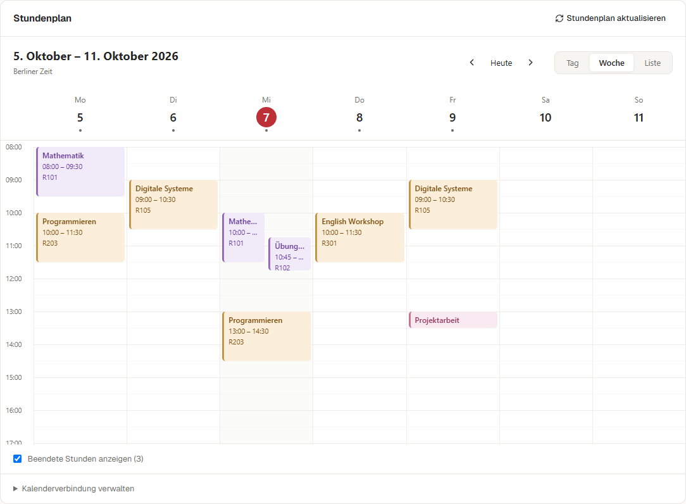
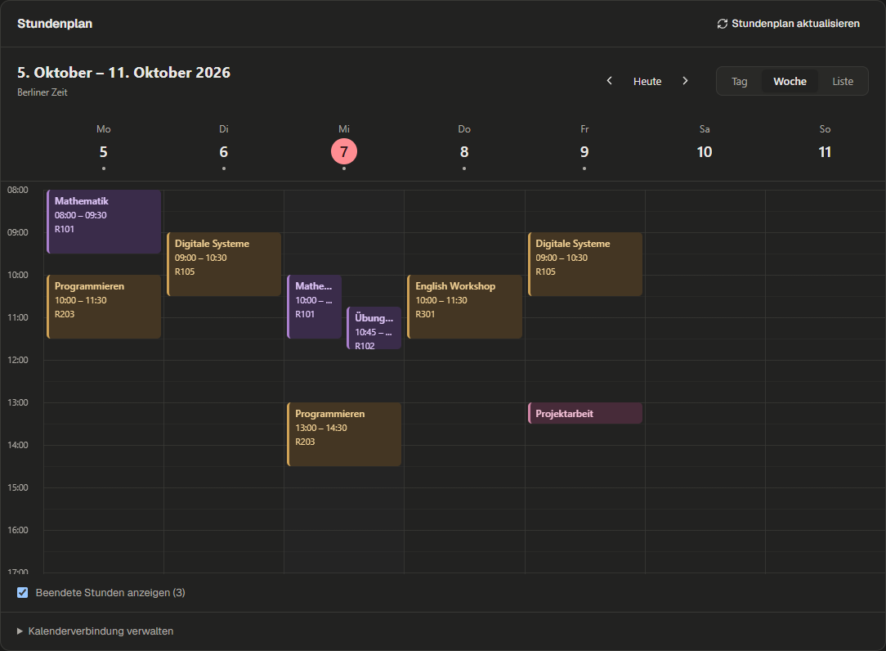
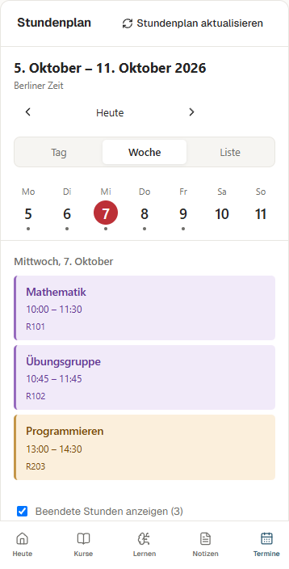
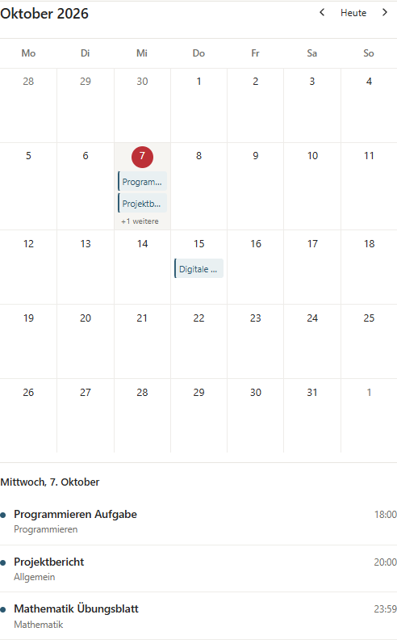

<!-- SPDX-License-Identifier: AGPL-3.0-or-later -->

# Kalender: ruhigere Tages-, Wochen- und Monatsansichten

## Nutzerproblem und Gestaltung

Die alten Tageskarten machten freie Zeit und Überschneidungen schwer erkennbar.
Im schmalen Monatsraster verschwanden lange Fristentitel. Die neue Oberfläche
orientiert sich an [Apple Kalender](https://support.apple.com/en-asia/guide/calendar/welcome/mac):
dezente Linien, farbige Termine, eine kompakte Datumsnavigation, markierter heutiger
Tag und ein Umschalter für Tag, Woche und Liste. Eigene Umsetzung; kein fremder
Quellcode übernommen, keine neue Abhängigkeit.

Die Woche beginnt montags. Gleichzeitige Veranstaltungen liegen nebeneinander,
Kursfarben bleiben bei einem Raumwechsel gleich. Der Zeitbereich wächst für frühe
und späte Veranstaltungen. Uhrzeiten bleiben in Europe/Berlin; mitgelieferte
Termine über Mitternacht werden pro sichtbarem Tag geteilt. Ein unbekanntes Ende
bekommt lediglich einen 30-Minuten-Platz im Raster, ohne erfundene Endzeit im Text.
Termine öffnen mit Klick oder Enter einen Dialog mit vollständigem Raum und Zeit.
Escape schließt und setzt den Fokus zurück.

Bei 390 px zeigt die Wochenansicht einen auswählbaren Tag als Agenda; Liste zeigt
die gesamte Woche. Pfeiltasten wechseln Tage, Home/End springen zum Wochenrand.
Die Fristen-Monatsansicht zeigt darunter alle Termine des gewählten Tages, nach
Uhrzeit sortiert. Pfeiltasten funktionieren über Monatsgrenzen, Heute setzt zurück.
Kursgruppen-Auswahl, Kalenderabo und die kompakte Heute-Ansicht bleiben erreichbar.

## Implementierung

- `TimetableCalendar.tsx` und `Calendar.css`: Navigation, Tages-/Wochenraster,
  responsive Agenda, Termin-Dialog und dezente Farben.
- `calendarLayout.ts`: lokale Wochen-/Zeitkoordinaten und getrennte Spalten für
  Überschneidungen; unabhängige Logiktests für Zeitzone, Jahreswechsel und DST.
- `DeadlineCalendar.tsx`: Monatsraster, Tastaturwahl und vollständige Tagesliste.
- `TimetablePanel.tsx`: vorhandene API, Sitzungszustand, Kalenderpflege und Filter.
- `DeadlineViews.tsx`: Integration sowie korrigierte Tabellenzellen für Screenreader.
- Texte vollständig über de/en-i18n. Keine Backendänderung oder Migration.

## Prüfung

Windows Chrome, ausschließlich erfundene Fixtures und eigene lokale Fake-Dienste.
Typecheck, vollständiger Frontend-Lint, i18n, Build und 10 gezielte Vitest-Tests
bestanden. 10 betroffene Playwright-Fälle bestanden, ohne Skip oder Retry:
vier neue Kalenderfälle, Gruppenwahl, drei persönliche Quellen-/Heute-Fälle und
zwei vorhandene Ansichts-/Lernbudget-Fälle.

12 Lighthouse-Snapshots der tatsächlichen gebauten Oberfläche: Woche, Monat und
Termin-Dialog, jeweils Light/Dark bei 1440/390 px. Alle Accessibility 100.
Ergebnis und SHA-256 des geprüften Builds stehen in
[`lighthouse-summary.json`](lighthouse-summary.json). Rohberichte liegen lokal
unter `dist/research/calendar-lighthouse`; keine echten Unterrichtsdaten gelesen.
Die Wochen- und Monatsbilder aller vier Geräte-/Themeprofile wurden visuell geprüft.






Reproduktion nach dem Frontend-Build:

```text
cd frontend
node node_modules/vitest/vitest.mjs run --configLoader native src/lib/calendarLayout.test.ts src/lib/timetable.test.ts
npm run e2e:focused -- calendar-apple.spec.ts timetable-selection.spec.ts personal-sources.spec.ts workspace-views.spec.ts
cd ..
node scripts/audit_calendar.mjs --fake-data
```

Das Audit verwendet eigene freie Ports 8198/4198 und beendet ausschließlich seine
eigenen Prozesse. Die Bilder zeigen Beispieldaten, keinen persönlichen Stundenplan.
Dies ist ein lokal geprüftes UI-Paket. Kein neuer Release, GitHub-Push oder
Serverinstallationsnachweis. MacBook-Trackpad und echtes Mitschreibtempo separat
nach `docs/MANUELL_TESTEN.md` prüfen; Browser-Testzeit misst kein menschliches Tempo.
