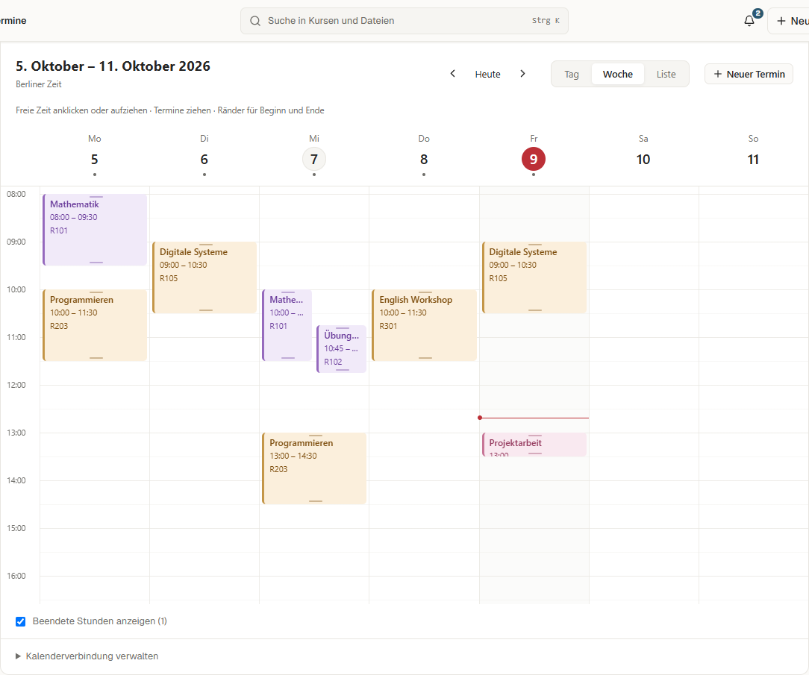
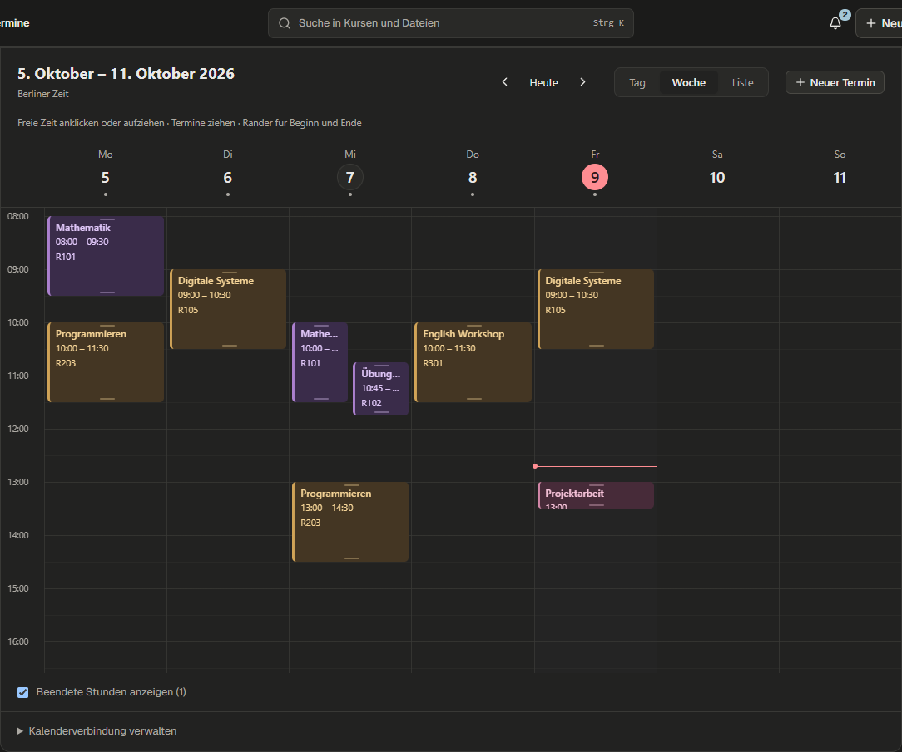
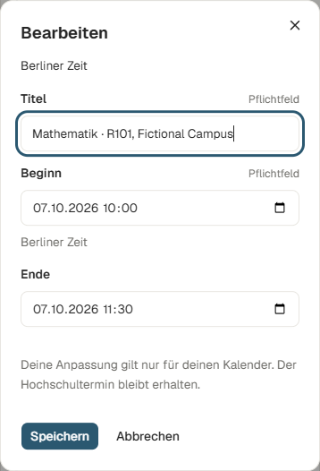

<!-- SPDX-License-Identifier: AGPL-3.0-or-later -->

# Kalender direkt bearbeiten — lokale Abnahme, 09.10.2026

Termine sind jetzt im Zeitraster verschiebbar und am oberen/unteren Rand verlängerbar. Eine freie Fläche anklicken oder aufziehen erstellt einen eigenen Termin. Vorschau und 15-Minuten-Raster zeigen die neue Position; Escape bricht ab. Nach Speicherung gibt es Rückgängig. Auf kleinen Bildschirmen steht das beschriftete Datums-/Zeitformular zur Verfügung.

Alt+Pfeil oben/unten verschiebt um 15 Minuten, links/rechts um einen Tag. Shift+Alt+oben/unten verändert das Ende. Der Dialog bietet alle Änderungen auch ohne Drag-Geste.

Hochschultermine behalten ihre Originaldaten. Änderungen werden als persönliche Anpassung gespeichert; Originalzeit und Wiederherstellung sind sichtbar. Eigene Termine lassen sich entfernen und wiederherstellen. Konkurrenzänderungen liefern einen Konflikt statt stiller Überschreibung. Undo-Verlauf bleibt im bestehenden LocalAction-System erhalten; die Toolbar zeigt die letzte eigene Aktion der geöffneten Ansicht.

Keine Datenbankmigration oder neue Abhängigkeit. Effektive Termine werden gemeinsam für Kalender, Export, Journal, KI-Kontext und Corpus/Suche verwendet. Interne Überlagerungen und entfernte Termine erscheinen nicht als zusätzliche Suchobjekte.

## Nachweise

Alle Daten synthetisch, keine echten Dokumente/Konten gelesen.

- Sechs neue Backendfälle prüfen eigene Termine, Originalschutz/Quelländerung, Undo/Identität, Konflikte, API-Validierung, DST/Übernacht und Corpus-Projektion. Betroffene Backendgruppe: **30 bestanden**.
- Vollständiger Backendlauf: **1014 bestanden**, zwölf übersprungen, sieben Windows-Pfadfehler. Alle sieben gehören zu unveränderten Datei-/Notiz-/Rebuild-/Submissionprüfungen. Wiederholung der betroffenen vier Testdateien in einem kurzen temporären Pfad: **19 bestanden**. Damit 1021 verschiedene Testfälle über Haupt- und Korrekturlauf bestanden, zwölf übersprungen. Kein vollständig grüner Einzellauf behauptet.
- Vitest: **716 bestanden / 81 Dateien**; darunter vier Editing- und acht Layoutfälle.
- Playwright: **355 unterschiedliche Fälle** abgedeckt. Hauptlauf 351 bestanden; vier alte Abläufe erwarteten ein dauerhaft sichtbares Kalenderabo-Formular. Tests öffnen nun ausdrücklich „Hochschulkalender hinzufügen“; gezielter Korrekturlauf **4/4 bestanden**, Produktbuild unverändert. Neue Editing-Spec enthält fünf Fälle, betroffene Kalendergruppe **10/10 bestanden**.
- Vollständiger Ruff-Lauf und mypy auf **579 Quelldateien** ohne Fehler. Typecheck/Lint, API-Generierung/-Prüfung, i18n de/en, Build und Bundlebudgets bestanden.
- 16 Screenshots: Woche, Fristenmonat, Termindetail und Editor, jeweils Light/Dark und 1440/390 px. Visuell geprüft. Lighthouse Accessibility **96–100**; keine Runtimefehler. Details: [Lighthouse-Übersicht](lighthouse-summary.json). Restbefund auf Desktop: kleine Pointertargets/Resize-Griffe; gleichwertiger Dialog und Tastaturänderung vorhanden. Keine vollständige Accessibility-Zertifizierung.

## Ansichten

## Noch manuell prüfen

Echtes MacBook: kurzer Klick öffnet Detail, Ziehen erst nach kleiner Bewegung; Two-Finger-Scroll, Pinch am Pointer, Randscrollen, deutsche Option/Alt-Kombinationen und WebKit-Fokus. Smartphone: Zeitformular, Tastatur, Vor-/Zurücknavigation. Screenreader: Datum, Dauer, Speicherfehler und Undo verständlich angekündigt. Automatisierte Windows-/Chrome-Tests belegen keine reale Mac-Trackpad-Ergonomie.

**Status:** lokal umgesetzt und geprüft. Noch kein neuer Installer, keine Serveraktivierung und keine Änderung an der installierten Version 0.1.21. GitHub-Release/Plattformfreigabe ist von diesem lokalen Nachweis getrennt.
