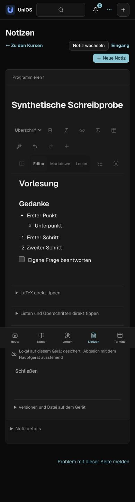
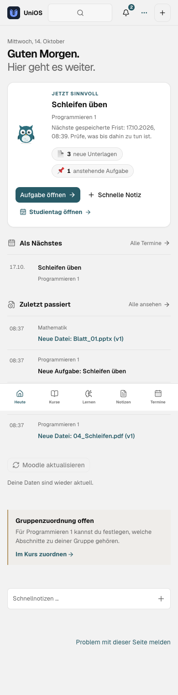
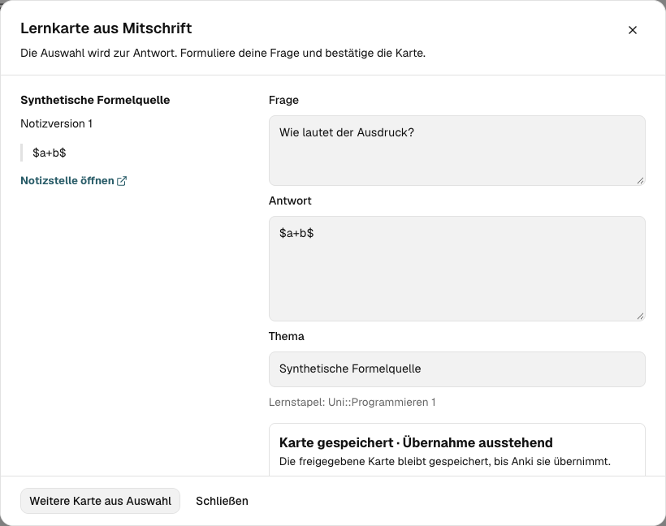

<!-- SPDX-License-Identifier: AGPL-3.0-or-later -->

# Vergleichsideen umgesetzt · 14.10.2026

Auftrag: die drei zuerst empfohlenen Verbesserungen umsetzen und Listen,
Nummerierungen sowie Überschriften beim direkten Tippen unterstützen.
Alle Prüfungen verwenden erfundene Daten und lokale Fake-Dienste.

## Schreiben

- Im Editor: `- `, `* ` und `+ ` erzeugen sichtbare Aufzählungen, `1. ` eine
  Nummerierung, `# ` bis `###### ` Überschriften und `> ` einen Zitatblock.
- Die Aufzählungen waren bereits strukturiert vorhanden, ihre Marker fehlten
  jedoch nach dem Tailwind-Reset. Explizite Listenstile gelten für Editor und
  Notizleser; Checklisten behalten ihre eigenen Checkboxen.
- Ein anschließendes `[ ] ` oder `[x] ` konvertiert nur den aktuellen
  Aufzählungspunkt zur Checkbox. Andere Punkte und deren Inhalt bleiben erhalten.
- Im Markdown-Modus setzt Enter Listen und Nummerierungen fort, neue Checkboxen
  beginnen leer. Enter auf einem leeren Punkt beendet die Liste. Tab und
  Shift+Tab ändern die Einrückung; Code bleibt wörtlich.
- Eine zugeklappte Eingabehilfe erklärt die Schreibweisen. Der gemeinsame
  Notizeditor wird auch für gespeicherte Mitschriften neben dem PDF verwendet.

## Lernkarte aus einer Mitschrift

In einer gespeicherten Mitschrift **Bearbeiten → Text auswählen → Lernkarte**.
Die Auswahl füllt nur die Antwort vor; Frage und Thema bleiben eigene Eingaben.
Erst „Karte speichern“ bestätigt die Karte. Das funktioniert im visuellen Editor
und im Markdown-Modus; Formeln behalten ihr LaTeX.

Die Quelle enthält Notiz-UUID, Revision, Prüfsumme, Kurs und Textauswahl.
Ein späteres Bearbeiten oder Verschieben in den Papierkorb verändert die
gespeicherte Herkunft nicht. Die Quelle öffnet die historische Notizrevision.
Geänderte Quellen werden vor einer neuen Speicherung abgelehnt; dieselbe
Speicherkennung kann ein bereits bestätigtes Ergebnis wieder abrufen.
Ein verlorener Antwortaufruf verwendet nach dem Neuladen dieselbe UUID.

Neue Notizkarten nutzen die vorhandene manuelle Kartenwarteschlange und die
Anki-Übernahme. Eine ausstehende Übernahme wird ausdrücklich angezeigt.
Für dieses Paket sind weder eine neue Abhängigkeit noch eine Datenmigration
notwendig. Ein älterer Server ohne den neuen Endpunkt verlangt ein Serverupdate;
der lokale Kartenentwurf bleibt erhalten.

## Offline-Vorbereitung pro Kurs

**Kurs → Auf diesem Gerät → PDFs und Notiztexte vorbereiten** speichert
aktuelle PDFs, notwendige Materialmetadaten und Notiztexte auf diesem Gerät.
Die Anzeige zählt tatsächliche Dateien und persistierte aktuelle Notizrevisionen.
Bekannte neue Versionen nehmen einem alten Download seine Bereitschaftsanzeige.

Das Paket lädt sequentiell und verarbeitet höchstens 200 Materialien sowie
200 Notizen, maximal 25 MiB je PDF und 150 MiB PDFs pro Vorbereitung.
Notizbilder, externe Links, andere Dateiformate, Übungen und der gesamte
Kartenbestand sind damit nicht vorbereitet; die Oberfläche nennt diese Grenze.

Gespeicherte Dateien gehören zum vorhandenen Kopplungsarbeitsbereich. Beim
Kopplungswechsel werden sie und bisherige API-Lesecaches entfernt; abgebrochene
alte Anfragen dürfen den neuen Cache nicht wieder befüllen. Browser nutzen den
Service Worker, native Clients lokale, widerrufbare Blob-URLs. Unvorbereitete
Datei-URLs bleiben unverändert. Downloadlinks behalten den Materialnamen.

## Konkreter nächster Lernschritt

„Heute“ zeigt eine Empfehlung mit passendem Ziel und Begründung:
gespeicherte Sitzung → aktuelle Anki-Tageskarten → nächste Frist/Aufgabe →
verfügbare Übungen → Lernübersicht. Die letzte Sitzung behält Quelle, Seite und
Notiz. Es gibt keine zusätzlichen API-Abfragen oder geschätzte Beherrschungswerte.

## Abnahme

- 1.292 Frontendtests bestanden; Typecheck, ESLint, 71 Sprach-Namespaces,
  Frontend-Build und OpenAPI-/API-Typenabgleich bestanden.
- 50 unterschiedliche betroffene Browserfälle bestanden: 49 im gemeinsamen
  Regressionslauf und der zusätzliche Formel-/Markdown-Kartenfall im finalen
  Vierer-Kartenlauf. Notiz-/PDF-Regressionsfälle sind enthalten.
- Gezielt 55 Karten-/Anki-Backendfälle bestanden; zusätzlich 41 Fälle nach der
  abschließenden Auswahlprüfung einschließlich 15 neuer Notizkartenfälle.
  Ruff auf versionierten Quellen und neuen Dateien sowie vollständiges mypy
  bestanden. Vollständiger Backendlauf: 1.256 bestanden, sechs übersprungen,
  ein unveränderter macOS-Signaturtest fehlgeschlagen. Dessen neu erzeugte,
  temporäre Signaturidentität wird nicht als gültige Code-Signing-Identität
  erkannt (`tests/test_macos_signing.py:84`); die neuen Studienfunktionen sind
  davon unabhängig. Es wurde keine Vertrauensrichtlinie des Rechners geändert.
- Hell/Dunkel auf 1440 und 390 px geprüft. Die historische Lesergalerie bleibt
  erhalten; aktuelle Leserbilder sind in diesem Paket versioniert.

Die Quelländerungen und der geprüfte PWA-Build sind lokal vorhanden. Dieses
Arbeitspaket ist kein neuer Installer, kein Serverdeployment und kein Nachweis
nativer Trackpad-, Sleep- oder geräteübergreifender Synchronisationsabnahme.

